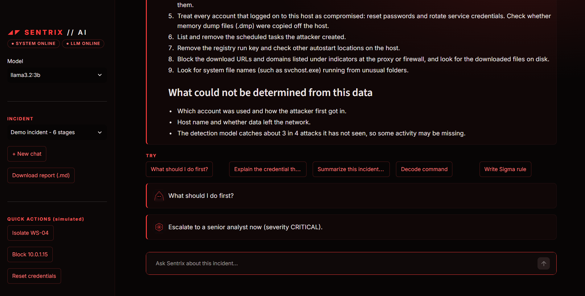
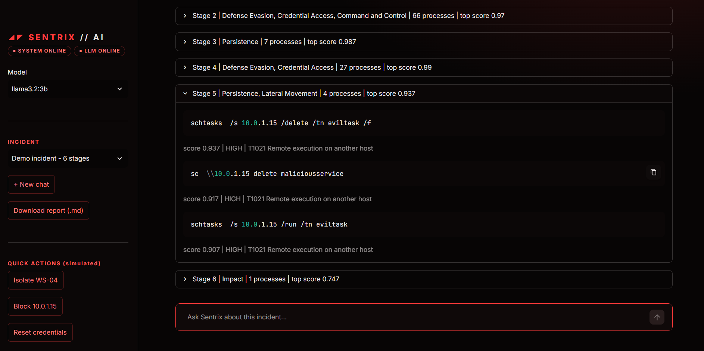

# Sentrix AI

A SOC analyst assistant that finds attack techniques in Windows Sysmon logs, rebuilds the attack chain with MITRE ATT&CK tags, and helps an L1 analyst triage it through a chat interface.



## What it does

1. **Detects** suspicious processes in Sysmon logs with a trained random forest (not rules alone, and not an LLM guessing).
2. **Reconstructs the attack chain** from Sysmon ProcessGuid / ParentProcessGuid links and groups it into stages.
3. **Tags each stage** with MITRE ATT&CK techniques using regex rules.
4. **Reports** severity, a timeline, exact commands, indicators and next steps. All facts are generated by code.
5. **Chat**: a local LLM (Ollama, llama3.2:3b) writes a short summary and answers questions about the incident. It only explains facts the code produced.



## Results (honest numbers)

Data: about 220,000 Sysmon events from the public Splunk attack_data repository, covering about 20 ATT&CK techniques. Labels are weak labels from rules plus parent-child propagation, so they are not hand-verified.

| Test | Precision | Recall |
|---|---|---|
| Leave-one-technique-out (17 techniques; model never saw the tested technique) | 0.86 | 0.72 |
| Stress test: 6 unseen techniques at once | about 0.85 | 0.61 |
| Random split (for comparison only, optimistic) | 0.85 | 0.92 |

The leave-one-technique-out figure is the one to trust. The random split leaks near-duplicate commands between train and test, so it is shown only to explain why the earlier numbers were too good.

PowerShell abuse is the weakest category.

## How the detection works

- **Unit of detection:** one process (its command line, parent, executable path and behaviour flags), not one log line.
- **Features:** command length, token count, 13 behaviour flags (encoded command, URL, download, IEX, bypass, hidden window, IP address, remote, persistence, credential dump, command chaining, script block, odd path), parent-is-shell, parent-is-Office and the top-20 executables.
- **Model:** RandomForest (300 trees, balanced class weights).
- **Confidence tiers:** score >= 0.7 is HIGH, 0.3 to 0.7 is REVIEW, below 0.3 is normal.
- **Baseline suppression:** known noisy test-harness and compiler processes (csc, cvtres, conhost, splunk, sandcat) and bare System32 binaries started by services are suppressed. This is a deliberate choice and is disclosed here.

## Limits

- **Process-only model.** It cannot see ransom notes, WMI subscriptions, or attacks that only touch the registry or files. In the demo, the encryption stage is tagged by rule, not found by the model.
- **Normal activity comes from lab data only.** A real enterprise would produce many more false positives. It needs tuning on the target environment.
- **Cloud and email attacks are out of scope.** This covers Windows Sysmon only.
- **The demo incident is stitched.** It is assembled from 6 separate public datasets to show a full kill chain. It is not one real attack.
- **Response actions are simulated.** Isolate, Block and Reset credentials log the action and show the command to run. Nothing is executed.
- **Weak labels.** Training labels are rule-derived, so the model can inherit rule blind spots.

## Features in the app

- Chat with the incident (streamed from a local LLM, nothing leaves your machine)
- Attack chain tab with stage cards and MITRE tags
- Evidence table of every flagged process
- Decode base64 PowerShell, and draft a Sigma rule from the top detection
- Simulated response actions with an action log
- Download the report as Markdown

## Run it

Requirements: Windows, Python 3.11+, [Ollama](https://ollama.com) with `llama3.2:3b` (`ollama pull llama3.2:3b`).

```powershell
git clone <repo-url>
cd soc-ai-project
python -m venv venv
.\venv\Scripts\Activate.ps1
pip install -r requirements.txt

# 1. download the Sysmon logs (about 20 datasets)
python src\list_datasets.py
python src\download_splunk.py

# 2. label, evaluate, train
python src\label_splunk.py
python src\train_splunk.py
python src\save_model.py

# 3. build the demo incident
python src\chain.py data\splunk\T1105__atomic_red_team__windows-sysmon.log `
  data\splunk\T1059.001__atomic_red_team__windows-sysmon.log `
  data\splunk\T1547.001__atomic_red_team__windows-sysmon.log `
  data\splunk\T1003.001__atomic_red_team__windows-sysmon.log `
  data\splunk\T1053.005__lateral_movement__windows-sysmon.log `
  data\splunk\T1486__dcrypt__windows-sysmon.log --brief

# 4. launch the app
python src\make_avatars.py
streamlit run src\app.py
```

## Project layout

```
src/label_splunk.py     weak labels + ProcessGuid propagation
src/features.py         feature builder
src/train_splunk.py     honest evaluation (leave-one-technique-out)
src/save_model.py       train on everything, save the model
src/chain.py            attack chain, ATT&CK tags, chain.json
src/reporting.py        analysis + report + Ollama helpers
src/app.py              Streamlit app
```

## Data and credits

Sysmon logs from the [Splunk Attack Data](https://github.com/splunk/attack_data) project (Atomic Red Team and other public datasets). Check that project's license before redistributing any data. This repository does not include the logs.

## What I would do next

More PowerShell training variety, file/registry/WMI event rules next to the process model, and evaluation on logs from a different environment.